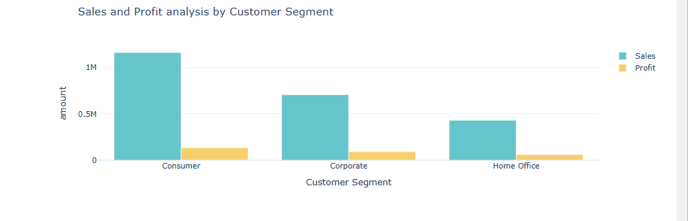
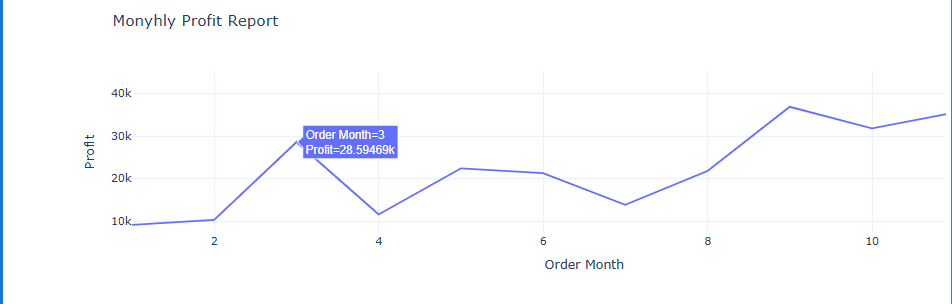
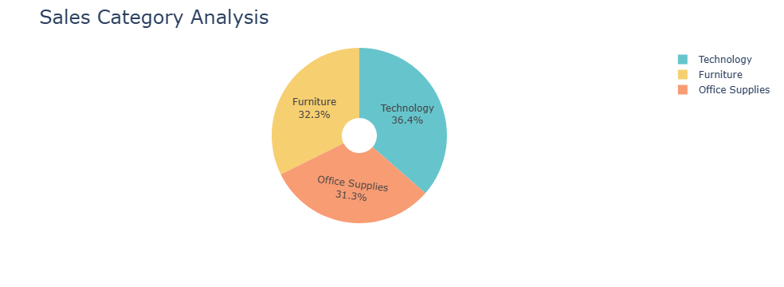

# E-COMMERCE-SALES-ANALYSIS
An interactive E-Commerce Sales Analysis project using Python, Pandas, and Plotly to explore monthly sales, product categories, sub-categories, profit trends, and customer segments through dynamic visualizations.

## Project Overview

This project focuses on analyzing e-commerce sales data using Python, Pandas, and Plotly. The goal is to explore sales and profit patterns, understand product category performance, and compare customer segments through interactive data visualizations.

Plotly is used to create dynamic charts that allow users to hover over visual elements and explore detailed values.

## Technologies Used

- Python
- Pandas
- Plotly Express
- Plotly Graph Objects
- matplotlib
- seaborn
- Jupyter Notebook

## Project Analysis

The project covers the following analyses:

- **ategory Sales Analysis:** Examined sales across different product sub-categories.
- **Monthly Profit Analysis:** Analyzed monthly profit trends.
- **Sub-Category Profit Analysis:** Compared profit across product sub-categories.
- **Customer Segment Analysis:** Compared sales and profit across customer segments.
- **Sales-to-Profit RaMonthly Sales Analysis:** Calculated monthly sales and explored the highest and lowest sales months.
- **Category-wise Sales Analysis:** Compared sales performance across product categories.
- **Sub-Ctio:** Calculated the sales-to-profit ratio for each customer segment.

## Visualizations
Interactive charts are created using Plotly, including:
- Bar Charts

- Line Charts

- Pie Charts
  

## Project Objective

The objective of this project is to practice Exploratory Data Analysis (EDA), understand sales and profit patterns, and develop interactive data visualization skills using Python and Plotly.

**Created by:** Md Faizan Alam
